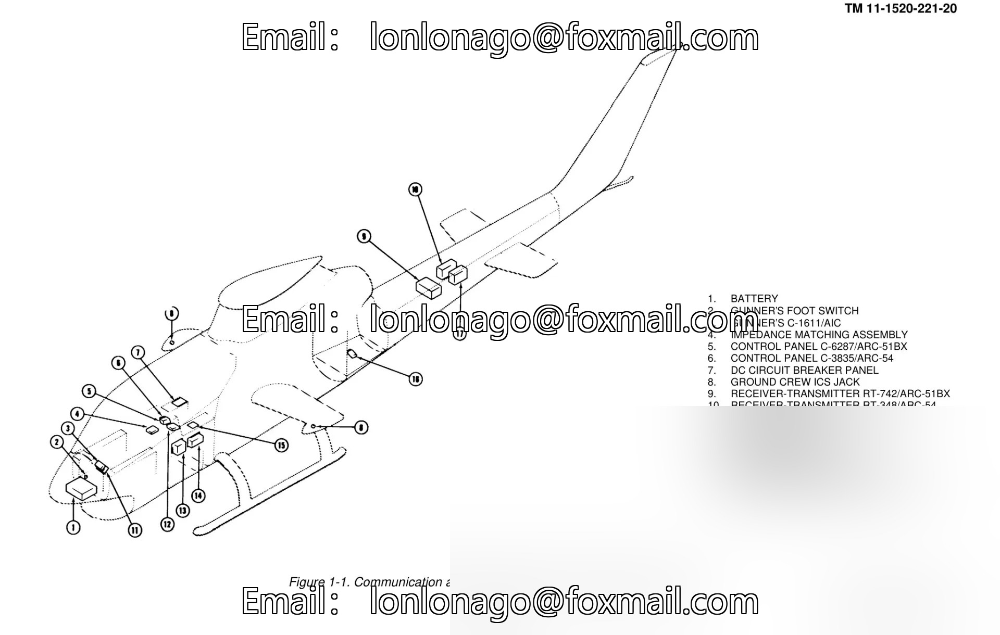
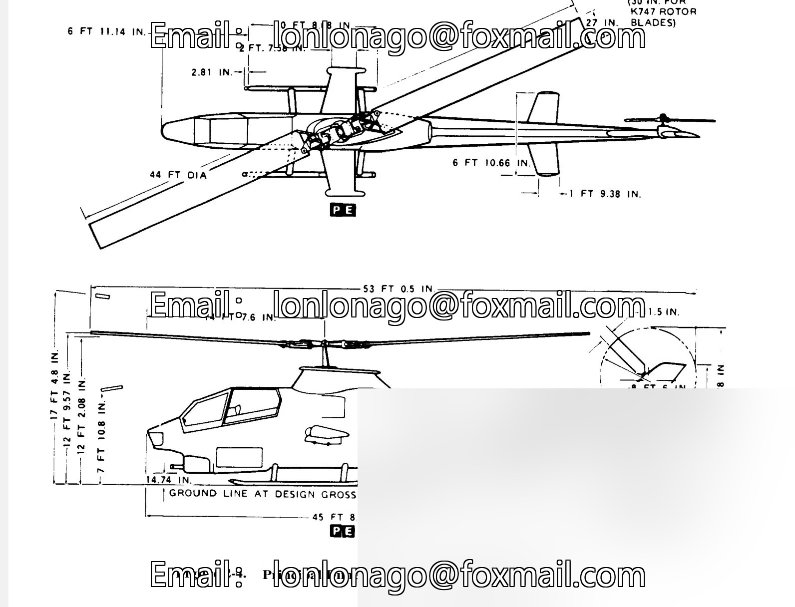
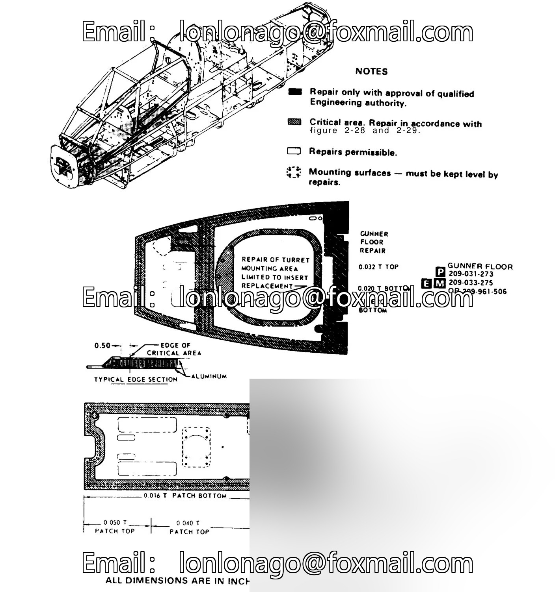
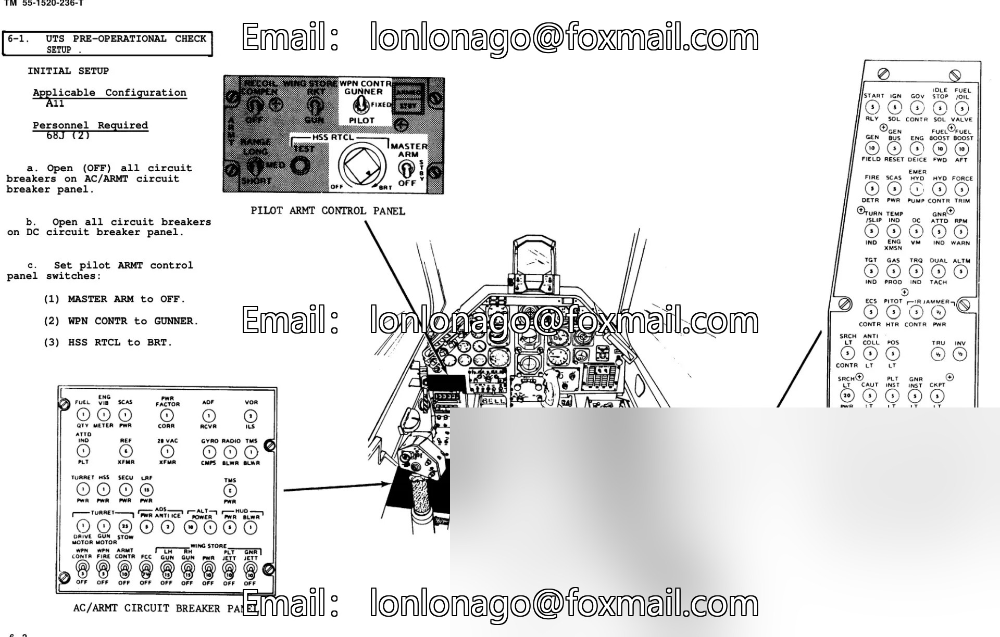
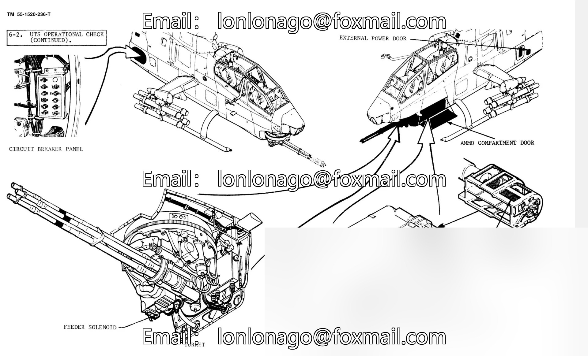
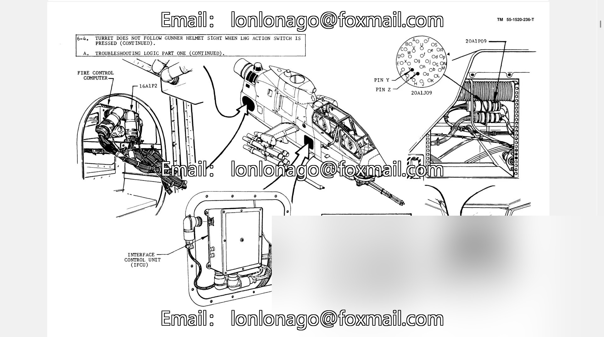

# AH-1 Helicopter Maintenance Handbook, Structural Repair Handbook (SRM) and

## Body

AH-1 Snake Bullet Armed Helicopter Maintenance Manual, Structure Repair Manual (SRM), and Wiring Diagram Manual (WDM) Electronic Collection. A total of 15 volumes.
The content includes detailed explanations of structure, systems, wiring diagrams, maintenance procedures, etc., suitable for military aviation maintenance and technical study reference.
The materials are in PDF format, electronically provided, and cannot be returned upon sale.

The collection consists of AH-1 cobras helicopter maintenance manuals, structural repair manuals (SRM) and wiring diagram manuals (WDM) totaling 15 volumes, containing detailed descriptions of structure, systems, wiring diagrams and maintenance procedures.

<!-- AI_ENRICHED -->

## Images

## Payment

Here is a pay link on Stripe ( https://buy.stripe.com/3cs8yP7sY87d0vu9AB ). Please contact me lonlonago@foxmail.com after funding $89, and I will send you a complete data files , thank you!

